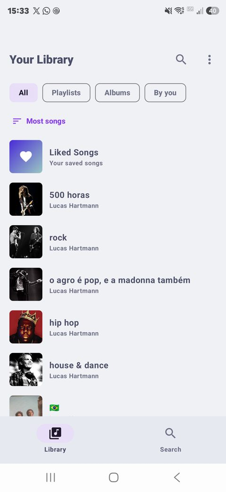
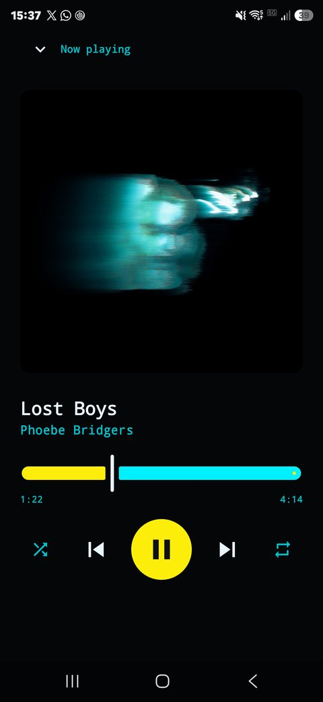
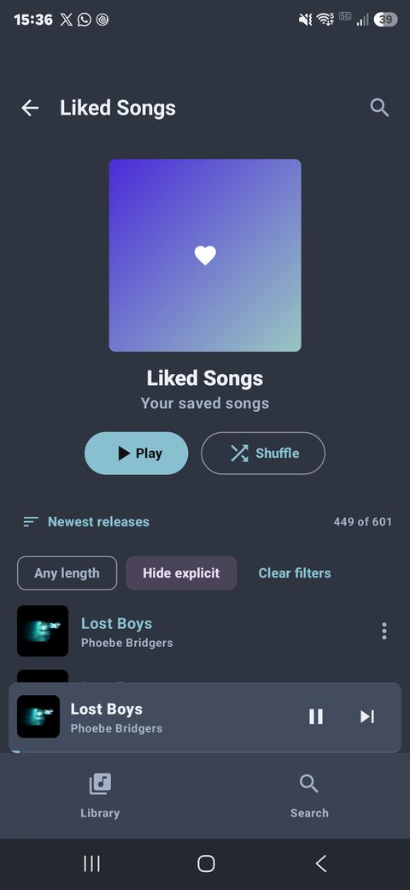
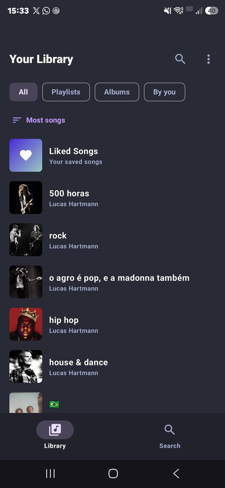
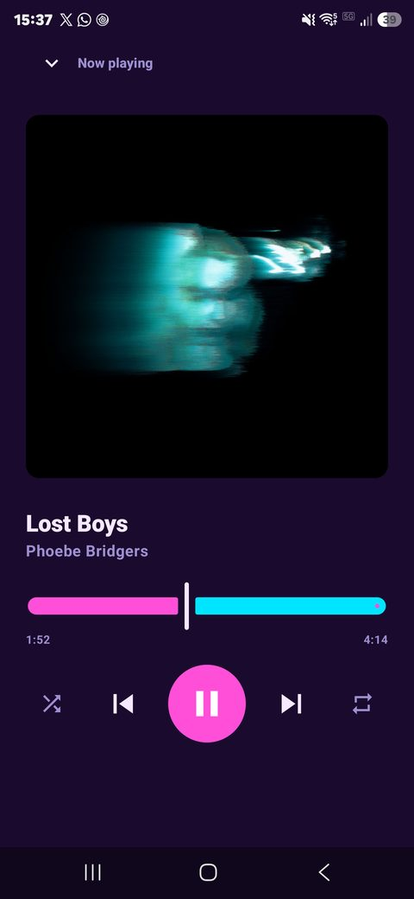
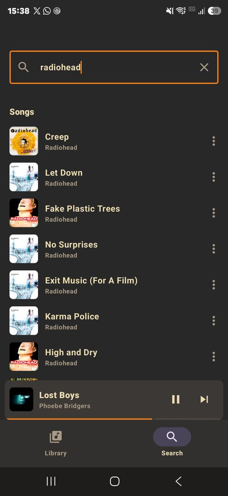

<p align="center">
  
</p>

<h1 align="center">Spotifast Mobile</h1>

<p align="center"><strong>Spotify on your phone: small, fast, and yours to theme.</strong><br>
A native client for Android, and for iPhone in preview, with a Rust core.</p>

<p align="center">
  <a href="https://github.com/batatinhafcbatatinha-pixel/spotifast-mobile/releases"><strong>Download the APK</strong></a> ·
  <a href="#get-started">Get started</a> ·
  <a href="android/README.md">Build from source</a>
</p>

<p align="center">
  <a href="https://github.com/batatinhafcbatatinha-pixel/spotifast-mobile/actions/workflows/android.yml"></a>
  <a href="https://github.com/batatinhafcbatatinha-pixel/spotifast-mobile/actions/workflows/ios.yml"></a>
  <a href="https://github.com/batatinhafcbatatinha-pixel/spotifast-mobile/actions/workflows/codeql.yml"></a>
  <a href="SECURITY.md#checking-a-download"></a>
  <a href="LICENSE"></a>
</p>

<p align="center">
  
  
  
</p>

**Playback needs Spotify Premium.** Spotifast Mobile is an unofficial,
experimental app, not affiliated with Spotify.

## Light where it counts

Measured on a Galaxy S24 Ultra, next to the official Spotify app on the same
phone.

| | Spotifast Mobile | Official Spotify app |
|---|---|---|
| Storage in use | **14.2 MB** in total (10.4 MB APK), and it stays there | 182 MB app + 298 MB cache |
| Memory | **about 120 MB** in use, library open | about 470 MB, in the background |
| Cold start | **0.14 – 0.25 s** to the library | not measured |

- **No growing cache.** Songs stream and covers stay in memory, so the app's
  storage does not grow as you listen. Temporary files are cleared every
  time it starts.
- **Native all the way down.** Playback is
  [librespot](https://github.com/librespot-org/librespot) in Rust, the
  interface is Jetpack Compose; there is no web view.
- **Only what you need.** One APK per phone architecture, no ads and no
  analytics of its own.

## Make it yours

<p align="center">
  
  
  
</p>

The app follows your phone's dark or light mode by default. In **⋮ → Theme**
you can choose:

- **Dark, Light and Black (AMOLED)**, each with six accent colours
- **Dynamic**: colours taken from the cover of the song playing, in the
  spirit of Dribbblish Dynamic and Lucid
- **Presets after popular Spicetify themes**: Catppuccin Mocha and Latte,
  Dracula, Nord, Gruvbox, Fluent, Comfy and Throwback
- **Something different**: 80s synthwave, 90s vaporwave, Terminal,
  Cyberpunk, Coffee and Rose. Some use the phone's own monospace or serif
  type, so they add nothing to the download.

## Everything you play, your way

- **Library**: Liked Songs, your playlists and saved albums. Sort by recently
  added, recently played, name, creator or number of songs; show only
  playlists, albums or the ones you made; filter by name.
- **Songs**: sort by recently added, title, artist, album, length or release
  date; filter by text, by length, or hide explicit songs. A sorted or
  filtered list plays in the order you see.
- **Search** songs, artists, albums and playlists.
- **Playback on the phone** through Spotify Connect: play, pause, skip, seek,
  shuffle, repeat and queue. Your phone shows up as a Connect device that
  your other Spotify apps can control, and you can take over what is
  playing elsewhere.
- **Plays in the background** with the system media notification, lock
  screen and Bluetooth controls. It pauses for calls and other apps, and
  when headphones are unplugged.

Not yet: offline downloads (librespot cannot), lyrics, podcast browsing,
playlist editing and Android Auto browsing.

## Get started

1. Download the APK from
   [Releases](https://github.com/batatinhafcbatatinha-pixel/spotifast-mobile/releases)
   and install it. Android asks you to allow installs from your browser or
   file manager the first time.
2. Register the app with Spotify, once: in the
   [Spotify developer dashboard](https://developer.spotify.com/dashboard),
   choose **Create app**, tick **Web API**, and add the redirect URI
   `http://127.0.0.1:8989/login`. It gives you a Client ID. A Client ID made
   for desktop Spotifast works too.
3. Paste the Client ID into the app and sign in with Spotify.
4. Tap **Set up playback here** and approve playback in the browser.

Everything runs on the phone; no computer is involved after you install.

## Is it safe?

- **Built in the open.** Release APKs are compiled from this repository's
  source by GitHub Actions, not on someone's computer. Each one carries a
  signed build provenance attestation, so you can check it came from here,
  unchanged:
  `gh attestation verify spotifast-mobile-<version>.apk -R batatinhafcbatatinha-pixel/spotifast-mobile`
- **Checked on every change.** CodeQL analyses the Kotlin app, the Rust core
  and the workflows; Dependabot keeps dependencies up to date.
- **Talks only to Spotify.** No Spotifast server, no analytics, no ads. You
  sign in in your browser, so the app never sees your password.

[SECURITY.md](SECURITY.md) has the details and how to report a problem.

## iPhone (preview)

The same app for iPhone, in SwiftUI over the same Rust core: library,
search, sorting and filters, themes, background playback and lock screen
controls. **It is built automatically but has not been tested on an iPhone
yet**, so expect rough edges and please report what you find.

iOS only installs apps from outside the App Store through a sideloading
tool:

1. Install [SideStore](https://sidestore.io) or
   [AltStore](https://altstore.io) on your iPhone.
2. Download `spotifast-mobile-ios-<version>.ipa` from
   [Releases](https://github.com/batatinhafcbatatinha-pixel/spotifast-mobile/releases)
   and open it with SideStore or AltStore, which signs it with your Apple ID.
3. Set it up as on Android (see [Get started](#get-started)).

With a free Apple ID the signature lasts 7 days; SideStore renews it from
the phone. A paid Apple developer account makes it last a year.

## How it is built

```
android/
├── core/   Rust: sign-in, Web API, librespot playback (JNI and a C ABI)
└── app/    Kotlin: Compose interface, Media3 session, playback service
ios/        Swift: SwiftUI interface over the same core, built by CI
```

See [android/README.md](android/README.md) for the architecture and how to
build it.

## Credits

Spotifast Mobile is a fork of [Spotifast](https://github.com/crmne/spotifast)
by Carmine Paolino, the desktop client for Linux, macOS and Windows. The
Android core reuses its sign-in code and its patched librespot. Themes are
inspired by [Catppuccin](https://github.com/catppuccin/spicetify),
[Dracula](https://github.com/dracula/spicetify),
[Nord](https://github.com/Tetrax-10/Nord-Spotify),
[Gruvify](https://github.com/Skaytacium/Gruvify),
[Fluent](https://github.com/williamckha/spicetify-fluent),
[Comfy](https://github.com/Comfy-Themes/Spicetify),
[Throwback](https://github.com/bluedrift/Spicetify-Throwback),
[Dribbblish Dynamic](https://github.com/JulienMaille/dribbblish-dynamic-theme)
and [Lucid](https://github.com/sanoojes/spicetify-lucid).

MIT licensed, like upstream: see [LICENSE](LICENSE).
